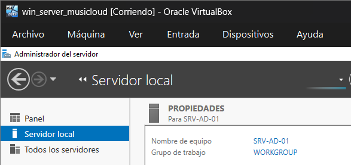
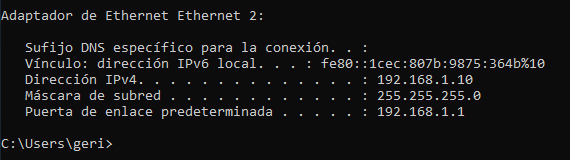
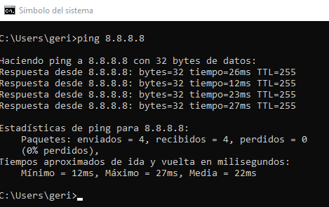
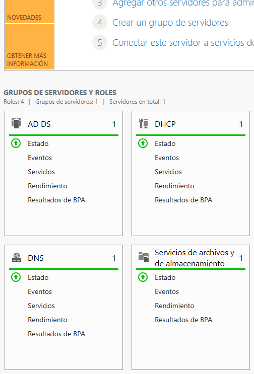
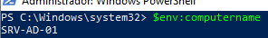
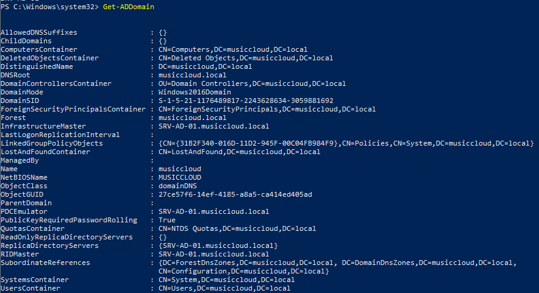
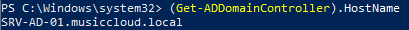
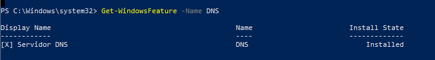
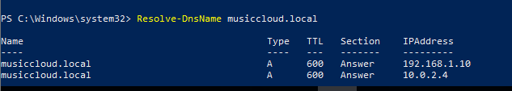

# Pràctica

## Objectiu

Preparar el servidor `SRV-AD-01` i promocionar-lo com a primer controlador de domini del domini `musiccloud.local`.
## Escenari

L’empresa **MusicCloud** vol iniciar la implantació d’Active Directory Domain Services.

El servidor Windows Server que s’utilitzarà com a controlador de domini serà:
```text
SRV-AD-01
```
El domini que es crearà serà:
```text
musiccloud.local
```
Aquest servidor també proporcionarà el servei DNS del domini.
## Tasques

### Part 1. Configuració inicial del servidor

Configureu el servidor perquè compleixi els requisits següents:

| Element           | Valor              |
| ----------------- | ------------------ |
| Nom del servidor  | `SRV-AD-01`        |
| Adreça IP         | fixa               |
| DNS preferit      | el mateix servidor |
| Connexió de xarxa | operativa          |
| Zona horària      | correcta           |
| Hora del sistema  | correcta           |
La configuració IP concreta dependrà de la xarxa del laboratori. Anoteu els valors utilitzats.

Nom servidor:


IP:

Comprovacio connectivitat:


Completeu la taula següent:

| Paràmetre        | Valor configurat |
| ---------------- | ---------------- |
| Adreça IP        |   192.168.1.10   |
| Màscara          |   255.255.255.0  |
| Porta d’enllaç   |    Ninguna       |
| DNS preferit     |   192.168.1.10   |
| Nom del servidor |   `SRV-AD-01`    |
### Part 2. Instal·lació del rol AD DS

Localitzeu i utilitzeu el procediment adequat per instal·lar el rol AD DS i promocionar el servidor a controlador de domini. Documenteu breument les comandes o passos utilitzats.

### Part 3. Promoció a controlador de domini
Promocioneu el servidor a controlador de domini amb les opcions següents:

| Opció                                  | Valor              |
| -------------------------------------- | ------------------ |
| Tipus d’implantació                    | Crear un nou bosc  |
| Nom del domini arrel                   | `musiccloud.local` |
| Servidor DNS                           | Sí                 |
| Catàleg global                         | Sí                 |
| Nom NetBIOS                            | `MUSICCLOUD`       |
| Controlador de domini de només lectura | No                 |
| Reinici final                          | Sí                 |
Definiu una contrasenya segura per al mode de restauració de serveis de directori.




### Part 4. Verificació

Després del reinici, comproveu:

1. Que el servidor s’anomena `SRV-AD-01`.

 

    
2. Que el domini `musiccloud.local` existeix.
        
3. Que el servidor és controlador de domini.
            
4. Que el servei DNS està instal·lat.
     
5. Que el DNS resol correctament el domini.
    
     
Completeu la taula següent. Adjunta la comanda que has utilitzat per a cada una de les comprovacions.

| Comprovació                          | Resultat |
| ------------------------------------ | -------- |
| Nom del servidor                     |`SRV-AD-01`|
| IP fixa configurada                  |192.168.1.10|
| AD DS instal·lat                     |  SI        |
| Domini creat                         | musiclcoud.local|
| DNS instal·lat                       |  SI       |
| Resolució de `musiccloud.local`      |     SI     |
| Eines d’Active Directory disponibles |     SI     |

## Preguntes

Responeu breument:

1. Per què `SRV-AD-01` necessita una IP fixa?
   
2. Per què és necessari DNS en un domini Active Directory?
   
3. Quina diferència hi ha entre instal·lar AD DS i promocionar el servidor a controlador de domini?
    
4. Quin és el nom del domini creat?
    
5. Quin és el nom NetBIOS del domini?
    
6. Per què no és recomanable que els clients del domini utilitzin un DNS extern com a DNS principal?
    