# `Select-Object` i `Where-Object`

> **Nota:** Els exercicis t'han de servir per familiaritzar-te amb PowerShell. No et limitis a executar les ordres: fes proves, modifica valors i propietats i observa què passa. Documenta les proves que consideris rellevants.
## 1. Investigar els objectes

Executa:
```
Get-Process
```
Observa la informació que mostra PowerShell.

Ara investiga un procés amb:

```
Get-Process |
    Select-Object -First 1 |
    Select-Object *
```
i:
```
Get-Process |
    Get-Member
```
Respon:

1. `Get-Process` mostra inicialment totes les propietats de l'objecte?

    No, Només en mostra unes quantes per defecte: Handles, NPM, PM, WS, CPU, Id, SI i ProcessName. L’objecte en té moltíssimes més, però PowerShell n’amaga perquè la taula no sigui tant extensa.

2. Quina diferència hi ha entre `Select-Object *` i `Get-Member`?

Get-Process | Select-Object * mostra els valors de totes les propietats de cada procés.
Get-Process | Get-Member mostra quines propietats i mètodes existeixen i de quin tipus són, però no els valors.

  3. Localitza almenys tres propietats que no coneixies. 
    
    PeakWorkingSet: la màxima memòria que ha arribat a utilitzar el procés (en el meu cas: 18710528 bytes).
    BasePriority: la prioritat base del procés (en el meu cas: 8).
    PagedSystemMemorySize: la memòria paginada del sistema que fa servir el procés (en el meu cas: 101544 bytes).
    
    Utilitza després `Select-Object` per mostrar únicament tres propietats que consideris útils.
    ## 2. Seleccionar propietats i objectes

    Amb `Get-Process`, construeix ordres que permetin:

    1. mostrar només `Name` i `CPU`;
     
     Get-Process | Select-Object Name, CPU
        
    2. mostrar només `Name`, `Id` i `CPU`;
    Get-Process | Select-Object Name, Id, CPU
        
    3. mostrar només els cinc primers processos;
    Get-Process | Select-Object -First 5
    4. mostrar només els tres últims processos.
    Get-Process | Select-Object -Last 3

    Respon:

    **Quina diferència hi ha entre seleccionar propietats i seleccionar objectes?**
    
    Seleccionar propietats és triar quines columnes veure, per exemple Name i CPU. Seleccionar objectes és triar quantes files veure, per exemple els 5 primers amb -First 5.

## 3. Ordenar i seleccionar

Construeix un pipeline que mostri els **cinc processos amb més CPU**.

La sortida ha de mostrar únicament:

```
Name
Id
CPU
```
Get-Process | Sort-Object CPU -Descending | Select-Object -First 5 Name, Id, CPU

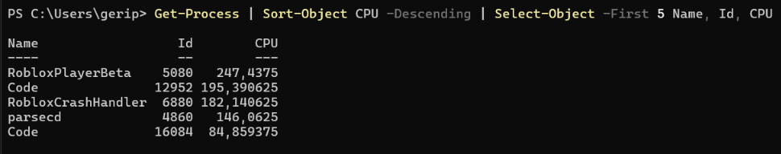

Compara després aquestes dues estratègies:

```
ordenar → seleccionar 5
```
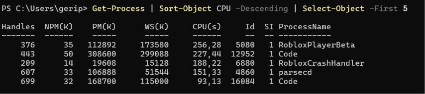
i:

```
seleccionar 5 → ordenar
```
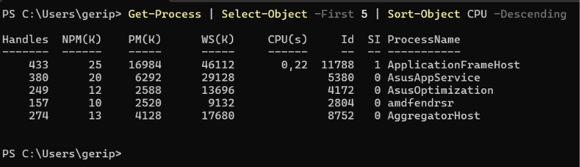

Respon:

1. Fan el mateix?
    No
2. Per què?
    En la primera s’ordenen tots els processos i després es queden els 5 amb més CPU. En la segona es queden els 5 primers que surten i només s’ordenen aquests 5, així que no són els que tenen més CPU.
3. Quants processos rep `Sort-Object` en cada cas?
    
    Ordenar → seleccionar: rep tots els processos.
    Seleccionar → ordenar: rep només 5.
## 4. Primer filtre

Crea:

```
$numeros = 5, 20, 3, 40, 12, 8, 30
```

Utilitzant `Where-Object`, mostra (adjunta comandes):

1. els números superiors a `10`;
    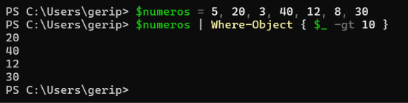
2. els números inferiors a `20`;
    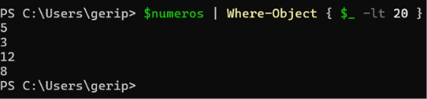
3. els números iguals a `12`;
    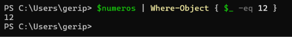
4. tots els números diferents de `20`.
    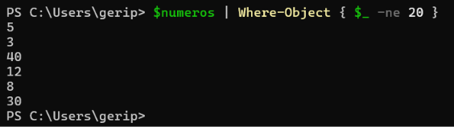
Per cada cas identifica quin operador has utilitzat:

```
-eq Números iguals a 12
-ne 
-gt Números superiors a 10
-lt Números inferiors a 20:
-ge
-le
```
## 5. Entendre `$_`

Utilitza:

```
$numeros = 5, 20, 3
```

i analitza:

```
$numeros |
    Where-Object { $_ -gt 10 }
```

Completa:
|Valor de `$_`|Resultat de `$_ -gt 10`|Passa el filtre?|
|---|---|---|
|5|False|No|
|20|True|Sí|
|3|False|No|

Explica amb les teves paraules:

**Què representa** `$_`**?**

$_ és el valor que s’està revisant en aquell moment. El pipeline va passant els elements d’un en un, en aquest cas, $_ és l’element actual: primer 5, després 20 i després 3.

## 6. Filtrar objectes per propietats

Executa:

```
Get-Service
```

Construeix un pipeline que mostri únicament els serveis que estan en execució.

La sortida final ha de mostrar només:

```
Name
Status
```
  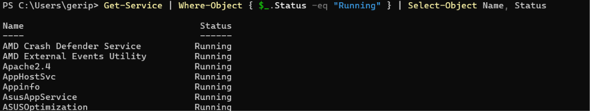
Després construeix-ne un altre que mostri els serveis que **no** estan en execució.

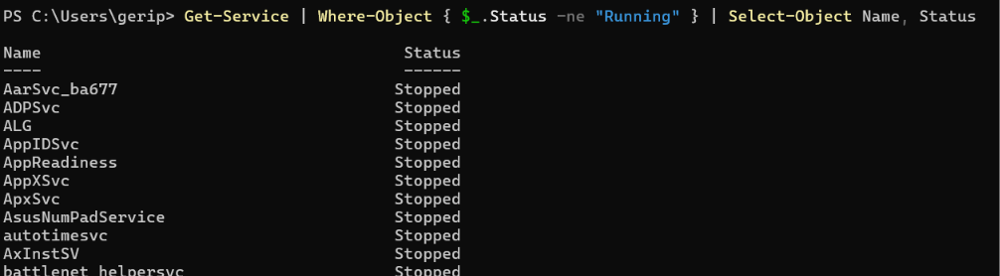
Respon:

1. Què representa `$_`?
El servei que s’està revisant en aquell moment.
    
2. Què representa `$_.Status`?
L'estat del servei.
3. Què fa `Where-Object` amb els objectes que no compleixen la condició?
Els descarta
4. Què fa després `Select-Object`?
Es queda només amb les propietats Name i Status de cada servei que ha passat el filtre.
## 7. Combinar condicions

Crea:

```
$numeros = 1, 5, 10, 15, 20, 25, 30, 40
```
Construeix filtres que mostrin:

1. números entre `10` i `30` ambdós inclosos;


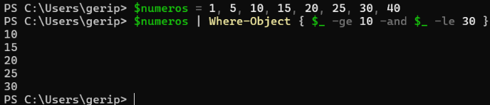
    
2. números inferiors a `10` o superiors a `30`.

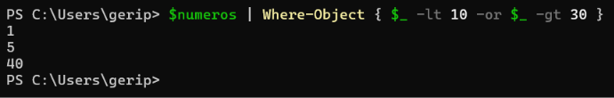
## 8. Pipeline complet

Construeix progressivament un pipeline que:

1. obtingui tots els processos;

    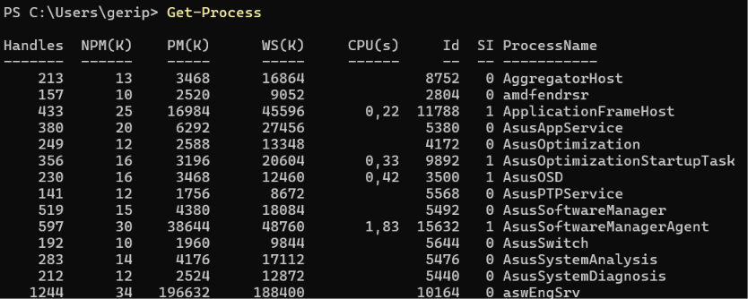
2. deixi només els processos amb `CPU > 5`;
    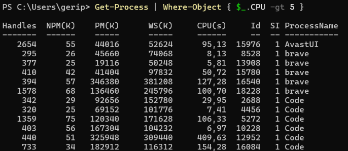
3. deixi, a més, només els processos amb `Id > 1000`;
    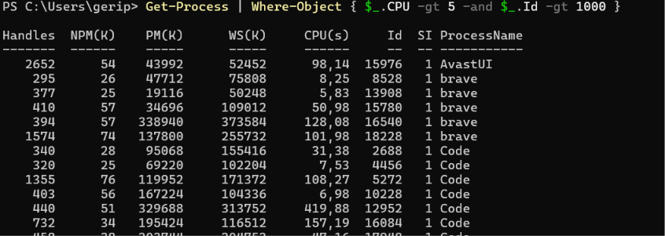
4. els ordeni de major a menor CPU;
    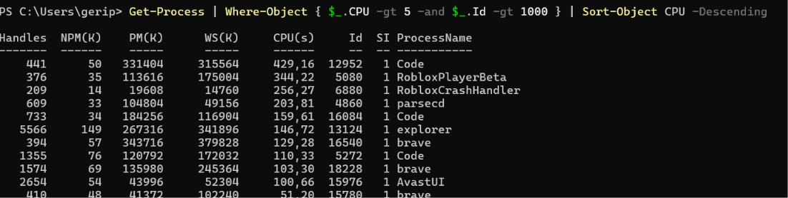
5. mostri només els cinc primers;
       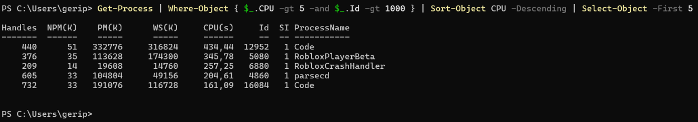
6. mostri només les propietats:
 
```
Name
Id
CPU
```

No intentis escriure directament tota l'ordre.

Executa-la després d'afegir cada nova etapa i observa com va canviant el resultat.

Representa finalment el recorregut:

```
Get-Process
     ↓
____________
     ↓
____________
     ↓
____________
     ↓
____________
```

Indica què entra i què surt de cada etapa.

|Etapa|Entra|Surt|
|---|---|---|
|`Get-Process`|res|tots els processos|
|`Where-Object { $_.CPU -gt 5 }`|tots els processos|només els de CPU > 5|
|`Where-Object { $_.Id -gt 1000 }`|els de CPU > 5|només els que a més tenen Id > 1000|
|`Sort-Object CPU -Descending`|els processos filtrats|els mateixos, ordenats de més a menys CPU|
|`Select-Object -First 5`|tots els ordenats|només els 5 primers|
|`Select-Object Name, Id, CPU`|els 5 processos|els mateixos 5, només amb 3 columnes|

## 9. Detectar errors de raonament

Un alumne vol obtenir els cinc processos amb més CPU:

```
Get-Process |
    Select-Object -First 5 |
    Sort-Object CPU -Descending
```

L'ordre funciona.

**Resol correctament el problema? Justifica la resposta i corregeix-la.**

No. L’ordre funciona, però el resultat és incorrecte.

Select-Object -First 5 es queda amb els cinc primers processos que surten de la llista, sense mirar la CPU. Després Sort-Object només ordena aquests cinc. Per tant, no són els cinc amb més CPU, sinó cinc qualssevol ordenats.

Correcte:
Get-Process | Sort-Object CPU -Descending | Select-Object -First 5

Primer s’ordena tot i després es seleccionen els cinc primers:

# 10. Conclusions

Explica amb les teves paraules:

1. Per a què serveix `Select-Object`?
    
2. Quina diferència hi ha entre seleccionar **objectes** i seleccionar **propietats**?
    
3. Quina diferència hi ha entre `Get-Member` i `Select-Object *`?
      
4. Per a què serveix `Where-Object`?
    
5. Què representa `$_`? I `$_.CPU`?
    
6. Què passa amb un objecte quan la condició de `Where-Object` retorna `True`? I quan retorna `False`?
     
7. Explica què entra, què surt i què fa cadascuna de les etapes:
```
Get-Process |
    Where-Object {
        $_.CPU -gt 10 -and $_.Id -gt 1000
    } |
    Sort-Object CPU -Descending |
    Select-Object -First 5 Name, Id, CPU
```
11. Es podria millorar l'ordre anterior fent alguna operació en un altre moment del pipeline? Justifica la resposta.
