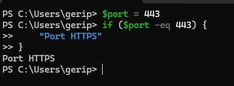
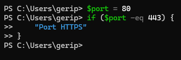
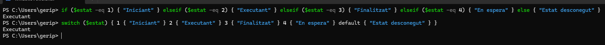
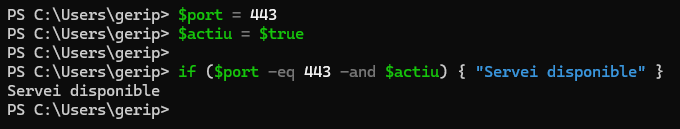
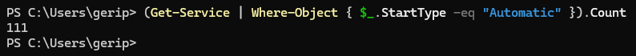
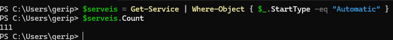

# Pràctica

## 1. Condicional

Crea:
```powershell
$port = 443
```
Mostra:
```
Port HTTPS
```
si el port és `443`.
 
 

Canvia després el valor de `$port` i comprova què passa.
 
 

 No surt res
## 2. if o switch

Crea:
```
$estat = 2
```
Fes que el programa mostri:

```
1 → Iniciant
2 → Executant
3 → Finalitzat
4 → En espera
qualsevol altre valor → Estat desconegut
```

Resol el problema utilitzant `if` i `switch`. Compara les dues solucions. 

 

Les dues donen el mateix resultat: Executant. Amb if has de repetir $estat -eq a cada cas. Amb switch poses la variable una sola vegada i només escrius els valors, així que és més curt i més fàcil de llegir quan hi ha molts casos sobre la mateixa variable.
## 4. Condicions combinades

Crea:

```powershell
$port = 443
$actiu = $true
```
Mostra:

```text
Servei disponible
```

només quan el port sigui el 443 i estigui actiu


 
## 7. Objectes

Quants serveis en el teu sistema estan configurats amb el servei d'arrencada automàtic quan s'inicia l'equip? 

Proposa diferents codis de resolució.

 

 Filtra els serveis amb arrencada automàtica i els compta amb .Count, tot en una sola línia.

  

  Guarda els serveis filtrats a la variable $serveis i després en mostra el nombre. Té l’avantatge que després pots tornar a fer servir $serveis per veure’n la llista.


# Conclusions

Explica amb les teves paraules:

1. Què representa la variable `$servei` en:
```powershell
$serveis = Get-Service
foreach ($servei in $serveis) {
    ...
}
```
2. Quina diferència hi ha entre `foreach` i `ForEach-Object`?
3. Què representa `$_` dins de `ForEach-Object`?
